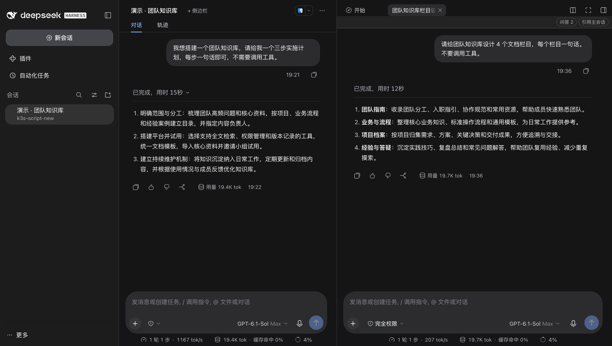
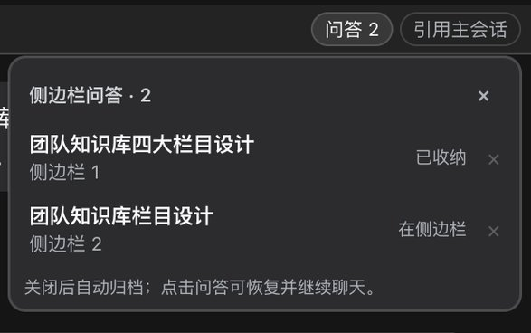
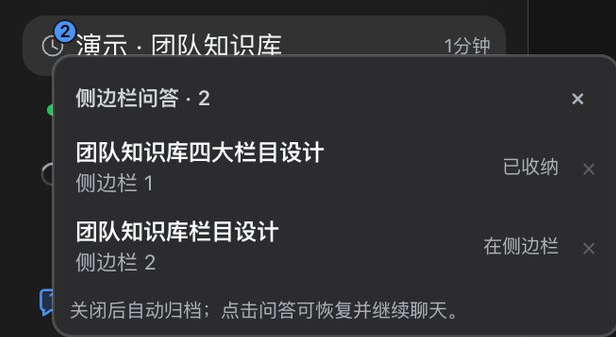

# Sidebar Agent

在 DSH Web 主会话下挂载**独立的侧边栏 Agent**。每个问答都是一个正常的 DSH Session，使用右侧栏的完整会话界面；它不会把消息、工具结果或结算通知写进主会话。

## 界面截图

以下截图来自实际安装的 0.3.3，使用独立的「演示 · 团队知识库」会话与测试文案。正文和标题均可直接阅读；无关会话已通过搜索筛选或裁切排除。

主会话与独立侧边栏各自使用完整 composer，问答入口保留在侧边栏工具条中：



| 问答列表与归档状态 | 定时任务图标与问答数量叠加 |
| --- | --- |
|  |  |

点击蓝色气泡或数量角标可打开问答列表；点击已归档条目会取消归档并恢复右侧标签。等待回答、等待审批、计划待确认、运行和未读状态优先于装饰图标显示，空闲后自动恢复。

## 0.3.3：问答数量与其他前缀图标叠加

- 只有问答时保留完整的蓝色对话气泡；同一会话的前缀插槽里还有时钟等图标时，问答数量缩成原图标右上角的蓝色角标，超过 9 条显示 `9+`，点击仍打开问答列表。
- 使用前缀 Slot 的现有 DOM 与 CSS 关系自动切换，不替换或移动其他插件的图标，也不读取定时任务内容。无问答的会话不受影响。
- 叠加规则只在原生前缀插槽挂载时生效；运行、确认和未读状态仍由 DSH 优先显示。此呈现依赖该插槽当前的 DOM 结构。
- 修复多页面同时打开时，新问答被另一页面误判为已关闭的问题。自动迁移只处理启动时已有明确关闭记录的旧问答；新建、恢复和打开中的问答不参与迁移。

## 0.3.2：后台操作不再产生聊天记录

- 问答列表读取、打开、关闭、归档改用 Connection 认证的专用后台接口，直接调用 Host 的归档逻辑，不再执行 slash command，不会新增 `command/run` / `command/done`，也不会为了读取列表而激活 Agent。
- 已有 `sidebar-question` 内部命令通过同名 Chat renderer 隐藏并移除行间空白，原始日志保留，其他命令正常显示。若历史分页只加载到孤立的完成事件，需加载对应开始事件后才能按名称识别。
- 旧页面仍使用原来的代码，请在更新后刷新；原有内部命令不再注册，避免旧页面继续写入。

## 0.3.1：常驻问答前缀

- 使用原生 `sidebar.session.row.leading` 插槽，在空闲、未归档且有关联问答的主会话标题前显示蓝色对话气泡与数量（超过 9 条显示 `9+`），无需悬停。点击直接展开原来的问答列表。
- 运行中、等待确认或有未读完成消息时，DSH 优先显示原生状态标识，前缀暂时让位；原有悬停操作区的“问答 N”与主会话内的入口继续可用。
- 不替换定时任务的前缀注册，不修改 DSH 底层代码。

## 0.3.0：问答入口与自动归档

- 左侧主会话行的操作区新增 **问答 N**（随原生行操作在悬停/键盘聚焦时显示）；主会话标题栏与右侧面板原有“历史”入口也改为“问答 N”。计数包含已归档问答。
- 点击入口列出关联问答，优先显示真实对话标题。点击条目先自动取消归档，再在原主会话的右侧恢复。来自其他主会话行时，会先切换到对应主会话。
- 关闭标签后自动归档，左侧默认隐藏已归档会话时不再显示；使用中的问答仍会暂时出现在普通列表。只收起右侧面板或切换主会话不会触发归档。
- 若还有运行中的回合、子代理、后台任务或启用的提醒，Host 保存待归档状态，待安全时重试，绝不自动停止任务。启用的周期提醒会持续阻止归档，直到提醒被删除。
- 待归档记录保存在 Host 的 `sidebar_agent_questions` KV 单元，关闭网页或 Host 重启后仍可继续。浏览器刷新恢复的标签会先解除归档再启用 composer。
- 升级时只尝试收纳已有明确关闭记录、且尚未纳入归档管理的旧问答；新建或打开中的问答不会因为另一个页面没有显示对应标签而被归档。已在主区域打开的子会话不参与该批迁移。
- 问答列表的移除按钮会先取消归档再移除入口，让独立会话仍可从普通列表找到；不会删除会话日志。
- `sidebar_questions` 工具与 UI 的专用后台接口调用同一个 Host 操作，支持 `list/open/close/forget`。UI 管理操作不会写入主会话或子会话的聊天记录，也不会启动模型回合。
- 不改动 DSH 底层列表、归档门禁或内置插件。插件升级无需重新打底层补丁。

侧边栏第一次收到提问时，Host 会自动把主会话的最近上下文作为一条独立的注入消息放进该轮请求；之后主会话有新增内容时，再按增量同步。用户不需要手动复制主会话历史。

从 `0.2.0` 起，原先独立的 `ask-selection` 已合并进本插件：在主会话里选中文字后，浮条直接提供 `复制` / `引用` / `在侧边栏提问`，不再需要安装第二个插件，也不再经过跨插件的客户端桥接。

## 为什么不是 subagent

DSH 内置 subagent 在本地激活被释放后，下一次 follow-up 会以 `delivery: 'parent'` 冷恢复，并向主会话追加 `subagent-settled`。这正是本插件要避免的污染。因此这里创建的是**普通 Session**：

- 没有 `parentAgent`，Host 不会向主会话追加结算消息；
- 保留完整 Session Controller API，直接复用官方 `conversation.content` 嵌入式会话；
- 因此自带完整 composer：模型选择、权限模式、计划模式、附件、停止、排队/steer、工具调用展示、follow-up。

代价是子会话是一个真实 Session：首轮之后会出现在 Session 列表里（通常在 workspace 下或 Ungrouped）。本插件与主会话的父子关系编码在子会话 id 里（`session-sb-<base64url(parentId)>.<uuid>`），Host 侧据此读取主会话事件；它不是 DSH 的 `parentAgent`，所以不会触发子代理结算或回写主会话。客户端 localStorage 只负责标签和历史入口。

## 功能

- **多标签**：每个侧边栏 Agent 一个右侧栏标签，支持同时打开多个；关闭后问答会安全归档，可从左侧数量气泡、悬停的 `问答 N`、右侧工具条或主会话标题栏重新打开。
- **自动主会话上下文**：侧边栏的第一条提问会自动带上一份主会话上下文包（标题、最近 6 轮用户提问/助手回答要点、工具动作、最近 2 条压缩摘要，最多 24000 字符）；如果这条提问来自选区引用，会优先带上选中内容所属轮次附近的对话，再补最近轮次。它是一条独立的注入上下文消息，位于你的提问之前，不会混进提问正文；侧边栏自己的对话日志仍只属于它自己。之后每次提问只同步上次位置之后的新事件（增量，最多 16000 字符），不会反复塞入完整历史。
- **新增确认**：当前主会话已经有侧边栏时，再点 `+ 侧边栏`（或从选区提问触发新建）会先提示已有数量和“仍要新增吗？”；取消就保持原样，不会创建空会话。
- **历史恢复**：`问答 N` 会列出该主会话下创建过的全部侧边栏（含已归档的）；关闭右侧栏标签会请求安全归档，不会删除会话。点击列表条目会先取消归档，再恢复标签和原对话。没有打开任何侧边栏标签时，主会话标题栏会保留一个 `问答 N` 入口。
- **从主会话引用上下文**：右侧栏侧边栏标签顶部的 `引用主会话` 会读取主会话已加载的 Session 事件（用户提问、助手回答、工具调用、压缩摘要），而不是只扫 DOM。弹层顶部可以一键 `引用主会话总结`（最近多轮脉络 + 关键回答 + 工具动作 + 已有压缩摘要），也可以选择单条提问，并按 `问题 + 完整回答 + 上下文` / `问题 + 完整回答` / `仅问题` 三种范围插入。默认追加到**当前打开的侧边栏**；没有打开的侧边栏时才新建。下拉框仍可手动选择其他已有侧边栏或 `+ 新建侧边栏`。插入目标是侧边栏 composer 的**草稿**，不会自动发送，也不会在主会话里留下任何消息。侧边栏是独立 Session，不会自动合并主会话；自动上下文只提供最近/增量参考，手动引用用于精确指定要带过去的轮次。
- **主会话总结**：总结由本地事件整理，不额外调用模型；包含主会话标题、最近轮次、每轮问题与回答要点、工具动作、最后一次回答和已有的 `compaction/summary`。如果打开了较早的侧边栏历史，会额外加载最多两页主会话旧消息；仍可能少于完整历史，草稿里会注明“更早历史未加载”。
- **选中文本操作（内置）**：在主会话消息里选中文字，浮条提供 `复制`、`引用`、`在侧边栏提问`。`引用` 把选中原文以引用块插入主会话 composer 草稿；`在侧边栏提问` 直接把原文追加到**当前打开的侧边栏**草稿，没有打开的侧边栏才新建。两条路径都不会自动发送。浮条不会出现在侧边栏内部会话、composer 或右侧栏面板中；新侧边栏仍进入本插件的历史记录。
- **历史移除**：历史弹层每行右侧的 `×` 会先展开“移除这条历史入口？”确认；确认后才把该侧边栏从当前主会话的历史映射中移除（并关闭对应标签），但**不删除子 Session**；适合清理入口，不适合删除对话内容。
- **独立模型**：子会话的模型选择是 per-session 的。子会话有明确选择后，主会话改模型不会影响它；子会话改模型也不会改主会话。
- **权限独立**：权限模式、计划模式、附件、停止/排队都走标准 composer，作用域是当前子会话。
- **刷新恢复**：右侧栏标签的地址（`contentId`）会被记住，并通过 localStorage 映射回子会话；刷新后标签、标题、对话都能恢复。
- **入口**：
  - 主会话标题栏的 `+ 侧边栏`：始终可用的新建入口；
  - 右侧栏每个侧边栏标签顶部：紧凑的 `问答 N` 和 `引用主会话`，只在当前标签对应主会话已有侧边栏记录时出现；
  - 主会话标题栏的 `问答 N`：仅在已有侧边栏记录、但当前没有打开任何侧边栏标签时出现，用于恢复；打开任意侧边栏标签后自动隐藏，避免重复入口。
- **打开即输入**：新建或切换侧边栏标签后，焦点会自动进入该标签的 composer；空白标签顶部会显示“独立会话，不会写入主会话”，避免误以为消息发到了主会话。
- **关闭入口**：关闭右侧栏标签会把入口收进 `问答 N` 并安全归档，**不会删除子会话**；恢复时自动取消归档，仍是原来的对话。在显示已归档会话时也能找到它。条目右侧的 `×` 会先要求确认，确认后取消归档并移除历史映射，同样保留子 Session。

## 结构

```text
sidebar-agent/
├── package.json          # DSH bundle + client 声明
├── cordis.patch.yml      # 插入 sidebar-agent 条目
├── index.js              # Host 侧：上下文注入、工具和后台接口注册
├── archive.js            # 持久归档控制与后台请求校验
├── archive.test.js       # 归档生命周期与请求传输回归测试
├── client.js             # 全部 UI / 会话编排
├── client.test.js        # 真实浏览器产物的多页面与关闭行为回归
├── docs/images/          # 使用独立演示会话与测试文案的实际截图
├── locale/{zh,en}.json
├── icon.svg
└── README.md
```

关键实现：

- 子会话 id：`session-sb-<base64url(parentSessionId)>.<uuid>`，Host 的 `parentOf()` 从中解出主会话；旧的无标记侧边栏不会被自动注入。
- 自动上下文：Host 监听 `agent/pre-step`，只在每轮第一步、且该步包含真实人类消息时执行。首次读取主会话事件并生成初始包；之后只取 `seq > 上次同步位置` 的事件生成增量包。注入消息的 `source.kind` 是 `sidebar-agent`，不会追加到主会话，也不会触发主会话运行。注入消息的 `source.sections` 里带一个 `sidebar-agent-sync` 同步位置；Host 模块重载后可从侧边栏自己的日志里恢复该位置，避免重复注入整包历史。
- 注入位置：独立上下文消息插在人类提问之前，因此不会把大段上下文写进用户消息正文；侧边栏当前嵌入式视图不会把注入正文当普通提问展示。
- 上下文读取：优先 `ctx.sessions.get(parentId).snapshotEvents()`；主会话未激活时回退 `sessionQuery.readSession(parentId)`。所有格式化和截断都在 Host 完成，客户端不参与。
- 入口类型：主会话标题走 `conversation.session.header.actions`；侧边栏标签顶部工具条渲染在 `sidebar.right.pane.tab` 的标签体内。选区浮条只借用 `conversation.composer.dock` 取得当前会话的 `inputActions`，未选中文本时返回 `null`，不会新增可见 composer 行；主会话底部不会多出一行，左侧栏也没有重复入口。
- 标签类型：`ctx.sidebarRightTabs.register({ id, kind: 'sidebaragent', multiple: true, title })`。
- 打开标签：`ctx.sidebarRight.openTabIn(parentSessionId, 'sidebaragent', { params: { childId, parentId, label } })`。
- 标签体：`useTabInfo()` 取 `contentId` / `navigation.params`，`ctx.sessions.retain(childId)` 后套 `SessionProvider`，渲染 `sidebar.agent.conversation`。
- 会话体：`renderFactorySlot('conversation.content', { variant: 'embedded', phase: 'active', hero: false }, ...)`，内部固定渲染 `conversation.session` 的 `chat` 视图，避免主会话的 `conversation.session.header` 重复出现。
- 标签恢复：右侧栏布局刷新后只保留 `contentId`，所以打开标签时通过标签类型的 `title(address)` 回调把 `address -> { childId, parentId, label }` 写进 localStorage；刷新后标签体与标题从该映射恢复。
- 引用上下文：`ctx.sessions.retain(parentId, { source: 'sidebarChat' })` 读取 `eventSource.getSnapshot()`，按 `turn/start`、`user/message`、`assistant/message`、`tool/call`、`compaction/summary` 重建轮次；只有 `source.kind === 'user'` 的 user 事件算人类提问，合成注入/压缩替换不会混入。DOM 扫描只作为 Session 尚未 ready 时的 fallback。总结按钮会调用 `loadOlder()` 最多两页旧历史。
- 历史弹层：标签顶部工具条里用 fixed 定位并向下展开；主会话标题栏的恢复入口也向下展开，避免被视口顶部裁切。
- 选区浮条：解析主会话 `[data-chat-flow-kind]` 中的 Selection/Range，拒绝 composer、右侧栏和 `[data-sidebar-agent]` 内的选区；浮条固定定位在选区上方/下方。`在侧边栏提问` 直接调用 `createThread` + `appendToThreadDraft`，走正常 Session composer，不创建额外只读线程；没有全局 `window` 桥接。

## localStorage 键

| 键 | 值 |
| --- | --- |
| `dsh.sidebar-agent.v1:<parentSessionId>` | `[{ id, label, index, createdAt, hidden?, closedAt? }]` |
| `dsh.sidebar-agent.child.v1:<childSessionId>` | 父会话 id（用于在子会话里隐藏入口） |
| `dsh.sidebar-agent.tab.v1:<contentId>` | `{ childId, parentId, label, updatedAt }`（刷新恢复） |

这些键只在浏览器本地，不进入 Session 日志；换浏览器/清 localStorage 后，已有标签会失去与子会话的映射。

## 安装 / 更新

### 从 GitHub 安装

在 DSH 的 **Plugins / 插件** 页面点 **Add plugin / 添加插件**，填入：

```text
https://github.com/liaosiqian/dsh-sidebar-agent.git
```

需要固定版本时使用 tag：

```text
https://github.com/liaosiqian/dsh-sidebar-agent.git#v0.3.3
```

也可以让 Agent 执行：

```text
plugin_manager
action: install_bundle
target: https://github.com/liaosiqian/dsh-sidebar-agent.git
```

安装后刷新页面。安装结果的 `application` 与 `warnings` 决定是否生效；若是 `restart-required`，需要重启。当前启用 HMR 的 DSH 支持先用 Plugin Manager 移除旧包、再安装本地新版，以重新加载 Host 模块；只禁用/启用不保证取得新的模块版本。已链接的本地包文件变化会在下一次 Plugin Manager 重组时检测，客户端仍须验证或刷新。

> `ask-selection` 已合并进本插件，不需要也不应再安装旧版 `ask-selection`；同时安装会出现重复浮条。

### 本地开发

在插件目录执行 `plugin_manager install_bundle`，或从 Plugins 页面选择本地目录。本地路径安装通常会创建 `link:` 依赖，移动或删除源目录后需要重新安装。

### 更新

修改代码并推送新 tag 后，在 Plugins 页面先移除旧版本，再安装新 tag；侧边栏的 localStorage 键和子 Session 日志不会因为插件更新而删除。

## 已知限制

- 使用中的子会话首轮后会暂时出现在 Session 列表；关闭并归档后从默认列表隐藏，不属于主会话的消息流。归档会清除原生置顶状态。
- 自动上下文只对带 `session-sb-` 标记的新侧边栏生效；升级前创建、id 里没有父会话标记的旧侧边栏不会自动注入。可以新建侧边栏继续问，旧对话仍可正常使用。
- 创建时继承父会话的 `agentPreset`（工具集）；创建后不能在该标签内切换 preset，只能换模型/权限/计划。
- 标签与历史入口的映射只在当前浏览器 localStorage；换浏览器打开同一 Session 不会自动恢复侧边栏入口，但子会话本身仍在 Session 列表里。
- 关闭右侧栏标签不删除子会话，避免误删对话；历史条目右侧的 `×` 只移除历史映射，也不删除子会话。DSH 本身提供归档与恢复，不提供会话日志删除。
- `引用主会话` 引用的是主会话里的**整条用户提问**或**事件摘要**，不是任意选中片段；选中片段请用内置浮条的 `在侧边栏提问`，会进入当前侧边栏草稿。
- 选区提问目前以**引用文本块**插入草稿，不是附件 chip；草稿只带选中原文，但 Host 会优先补上选中内容所属轮次附近的主会话对话，再补最近轮次；如果无法解析所属轮次，则回退最近 6 轮。需要精确控制时仍可用 `引用主会话`。
- 选区提问默认复用打开的侧边栏；浮条本身没有“新建侧边栏”按钮，需要新侧边栏时可以直接在浮条点 `在侧边栏提问`（没有打开的侧边栏时会新建，已有历史时会先确认），也可以先用主会话标题栏的 `+ 侧边栏` 打开一个再选。
- 引用范围由弹层里的下拉框控制；`问题 + 完整回答 + 上下文` 会插入整条提问、该轮回答、相邻轮次和最近 5 轮脉络，`问题 + 完整回答` 只插入前两项，`仅问题` 只插入问题。超长内容会截断，并在草稿里标注 `reference-only`。
- 总结来自本地事件整理，不是模型再总结；事件窗口只包含当前已加载的历史。总结按钮会最多加载两页旧历史，但很长的会话仍可能显示“更早历史未加载”。已有压缩摘要会一并带入，不会重复展开被压缩掉的原文。
- 引用默认追加到当前打开的侧边栏；没有打开的侧边栏才新建。引用到已关闭的侧边栏时会自动重新打开标签；如果目标侧边栏正在提交，会提示稍后再试，不会强行插入。
- New Session 页没有主会话标题栏，也不显示侧边栏入口；先进入会话，再用标题栏的 `+ 侧边栏`。已有侧边栏可在该会话标题栏的 `问答 N` 中恢复。
- 历史记录只存在当前浏览器的 localStorage；换浏览器或清 localStorage 后，标签与历史的映射会丢失，但子 Session 仍在 Session 列表里。
